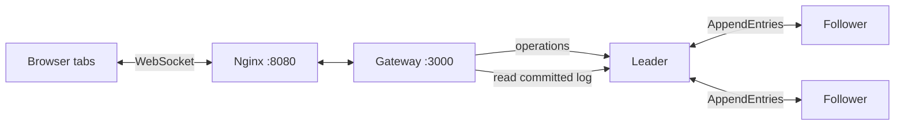
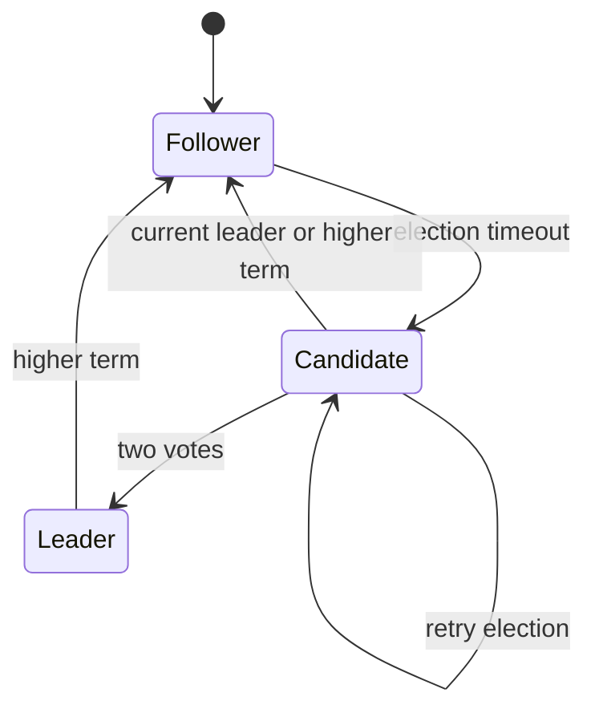

# MiniRAFT notes

This follows the three-replica drawing board in [MiniRAFT.pdf](MiniRAFT.pdf), including the optional shared undo/redo. It is a small consensus exercise, not a production Raft library.

## The path of a drawing



`frontend/board.js` scales pointer positions into a fixed 1100 x 680 canvas. Segments in one gesture share a `drawId`. Uncommitted marks use a separate preview canvas, so a local preview cannot change the shared drawing order. PNG export includes only the committed canvas and its paper background.

`gateway/server.js` keeps browser connections open while it looks for a leader. It polls replica status every 400ms, sends at most 64 operations per batch and reads committed log pages every 150ms. Leader notifications trigger another read; the gateway never inserts the notification body into its board cache. A new tab gets a replay followed by live operations.

`replica/server.js` is shared by all three nodes. Each entry is `{term, data}`. The leader tracks each follower's matched index separately, so a slow or stopped follower does not hold up the other one. A successful write response means accepted by the leader, not committed. Browser acknowledgements are sent only after the gateway reads the committed entry.

## Elections and recovery



Followers start an election after a random 500-800ms without a valid leader message. A candidate increments its term, votes for itself and asks its peers. A node grants one vote per term while running, and only to a candidate whose log is at least as up to date. Two votes elect a leader. Leaders send heartbeats every 150ms; replica RPCs time out after 250ms.

A higher term makes a node step down. Delayed RPC replies cannot move the term backwards. The leader advances its commit index when an entry from its current term has reached a majority. Each new leader appends a no-op entry so earlier entries can also finish committing. No-ops count toward log indexes but do not draw anything.

AppendEntries checks the preceding index and term before accepting entries. Conflicting uncommitted entries can be replaced; the committed prefix is protected. A restarted follower has an empty log and requests committed pages from the leader's `/sync-log` endpoint. Each page has up to 64 entries. Normal replication handles the remaining tail.

| Situation | Result |
| --- | --- |
| One follower stops | The leader and other follower still commit. |
| Leader stops | The two followers elect a replacement. Commits pause briefly; browser connections stay open. |
| A stopped node returns | It catches up before the next failure demo. |
| Two nodes stop | No new majority commits. Marks stay pending, then show unconfirmed feedback. |
| Gateway restarts | Tabs reconnect, resend pending operations and replay the committed log. |
| Whole stack stops | All in-memory state is lost. Start a fresh session. |

## Retries and undo

Each operation has a `clientId` and `strokeId`. Replicas deduplicate these IDs, including after a follower catches up. Reusing an ID with different content is rejected. The gateway keeps its committed-ID cache across clear operations, so retrying an old mark cannot restore a cleared drawing.

The gateway holds at most 4096 pending operations; each browser holds at most 1024. Gateway retries use the same IDs about every 700ms. A write without a confirmed commit after 15 seconds is reported as unconfirmed. This is not a promise that an already accepted entry can never commit later. The browser keeps unconfirmed operations for an explicit retry and resends still-pending ones after reconnecting. Closing or reloading a tab can lose its unsent marks.

Undo and redo are operations targeting a `drawId` within that client's identity. `frontend/boardState.js` replays them to decide which gestures are visible. Undo also works for erasing. Clear resets the visible board and undo history for everyone. Client IDs group edits; they are not authenticated user accounts.

## Useful endpoints

| Service | Endpoint | Purpose |
| --- | --- | --- |
| Gateway | `WS /ws` | Drawing operations, replay, pending status and commit acknowledgements. |
| Gateway | `GET /dashboard-data` | Replica status, quorum, pending count and recent events. |
| Gateway | `POST /clear` | Queue a replicated clear. |
| Replica | `GET /status`, `GET /log` | Node state and committed board operations after the last clear. |
| Replica | `POST /stroke`, `POST /strokes` | Leader-only single or batched operations. |
| Replica | `POST /request-vote` | Election RPC. |
| Replica | `POST /append-entries` | Prefix check, replication and commit progress. `/heartbeat` accepts the same fields. |
| Replica | `POST /sync-log` | Read a page from `from_index`; optionally check `prev_log_term`. |

Nginx maps `/api/` to gateway HTTP routes and `/ws` to its WebSocket. Host debug ports 3000 and 4001-4003 bind to localhost. There are basic payload checks and size limits, but no authentication between services. Run this on a local machine or trusted lab network.

## Development and verification

`replica1/server.js`, `replica2/server.js` and `replica3/server.js` are separate watch entry points. Editing or touching one restarts only that replica:

```sh
touch replica1/server.js
docker compose logs --tail=30 replica1
```

Shared logic is baked into the image. Rebuild and recreate one node at a time, letting it catch up before moving on:

```sh
docker compose up --build -d --no-deps replica1
docker compose up --build -d --no-deps replica2
docker compose up --build -d --no-deps replica3
```

The test suite starts three real Node processes and a gateway on temporary ports. It covers follower loss, leader replacement, rejoin, gateway restart, missing quorum, committed-prefix protection, stale replies, malformed input, retry deduplication, clear order, buffer limits and shared undo/redo. Run `npm test` after installing both service dependencies as shown in the README.

`node scripts/failoverDemo.js` tests the running Compose stack through Nginx and restores any node it stops. It respects Compose's `COMPOSE_PROJECT_NAME` and `DOCKER_HOST` variables; `BOARD_URL` changes the frontend URL. A typical run prints a leader, three committed drawings, a replacement leader and matching commit indexes.

Logs and the deduplication history grow for the life of the session. There is no disk log, snapshot compaction, membership change or guarantee for overlapping restarts that erase a majority's state. Keep failures one at a time for the assignment demo.
